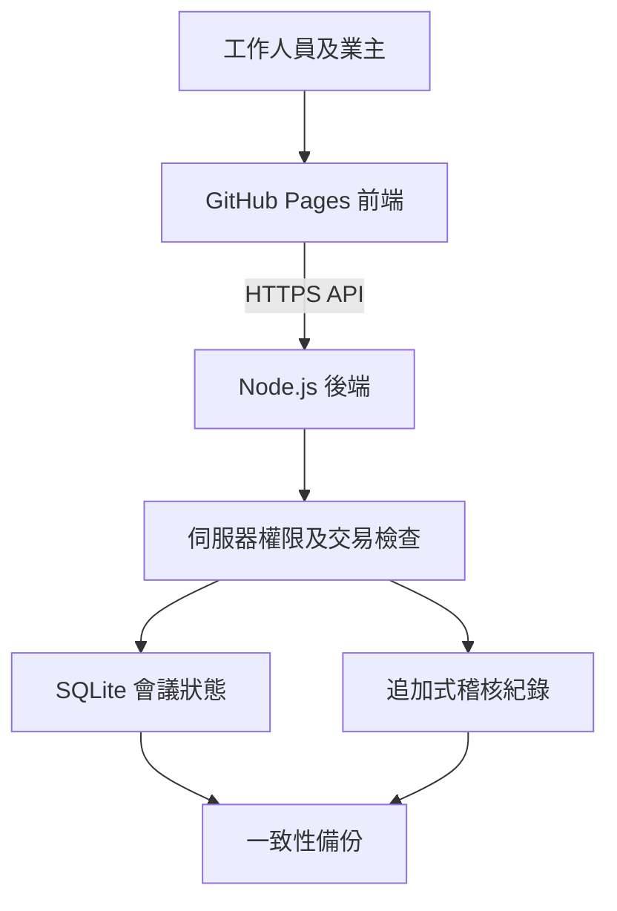

# 澳門業主大會系統：前後端架構與操作手冊

版本：0.3.0｜2026-09-21

## 1. 本次交付及實際狀態

已製作可運行的多人工作台及 Node.js／SQLite 後端，沿用原單機版及計票核心。前端不是假登入示範：登入、權限、錄票、截止及結果均由後端核對。**後端尚未部署到公開主機，因此公開前端不能單獨提供多人同步。**

| 項目 | 本版實作 | 限制 |
| --- | --- | --- |
| 原單機版 | 保留報告、JSON備份還原及計票修正 | 不與多人資料庫自動互通 |
| 模式選擇 | 每場A／B／C，開始後鎖定 | 不支援同場紙票及電子票混合 |
| A現場電子票 | 核實身份後逐單位發8小時憑證；截止前可改票 | 憑證持有者可使用，沒有自動人臉／證件認證 |
| B現場＋遠端 | A功能加電子方式及遠端出席依據確認 | 不自動判斷遠端程序法律有效性；沒有視像出席功能 |
| C紙票協作 | 唯一QR、收發登記、雙人盲錄、差異裁定、註銷补發 | 實物交收及紙票判定須人手執行 |
| 同步 | 寫入共用資料庫；觀察員及業主每5秒刷新 | 工作人員有新版本提示，按更新後繼續；不是WebSocket |
| 備份 | 完整業務JSON及SQLite一致性備份工具 | 多人JSON暫無網頁還原；災難恢復用SQLite快照 |
| OMR | 資料結構及擴展方案已規劃 | 尚未實作方格辨識、批量掃描或圖像上載 |

這是可部署及試行的開發版，尚未完成正式大會所需的全部實機及運維驗收。

## 2. 前端、後端與資料流



| 檔案 | 責任 |
| --- | --- |
| `index.html` | 原單機版實際入口；新增多人工作台連結 |
| `meeting-core.js` | 共用份額、規則、CSV及v1備份驗證；後端重新計算，不信任前端結果 |
| `multi.html` | 多人頁面入口、登入及使用說明 |
| `multi.css` | 手機／桌面版面、紙票與報告列印樣式 |
| `multi.js` | 角色介面、API、紙票讀碼、盲錄、電子票、列印及更新提示 |
| `server/domain.cjs` | 會議狀態機、模式門檻、票據生命週期及角色化輸出 |
| `server/server.cjs` | HTTP API、scrypt密碼、登入、SQLite交易、CORS及稽核 |
| `server/backup.cjs` | 使用SQLite備份API建立一致快照 |
| `server/manage-user.cjs` | 主機端停用帳戶／重設密碼並撤銷舊登入 |
| `Dockerfile` | Node 24容器，資料庫放獨立持久磁碟 `/data` |
| `app.jsx`／`macau_owners_meeting.tsx` | 舊稿，沒有接入實際入口；不要修改它們期待網站更新 |

多人前端不依賴外部React／Tailwind CDN；QR圖由後端 `qrcode` 套件產生。原單機版仍使用CDN。

## 3. 資料庫及一致性

| 資料表 | 重要欄位 | 用途 |
| --- | --- | --- |
| users | id、唯一username、password、role、meeting_id、active | 工作人員身份及限定會議 |
| sessions | 雜湊token、user_id、expires | 8小時登入；登出撤銷 |
| meetings | id、state JSON | 每場完整狀態及revision版本 |
| audit | id、meeting_id、actor、action、at、detail | 每次業務寫入及帳戶建立紀錄 |

`state` 內含原始名冊／議程、投票方式及依據、議程開票時的出席快照、紙票、電子憑證雜湊、電子票及截止紀錄。

紙票包含 `id、agendaId、unitId、share、batch、issuedAt、receivedAt、entries、resolution、voided`。QR只包含隨機UUID，不含姓名、證件或份額。份額從已鎖定名冊取用，不能靠QR自行改票重。

每次工作人員提交都帶 `revision`。後端在 `BEGIN IMMEDIATE` 交易內重新讀取狀態、核對版本和權限，保存新狀態及稽核後一併提交。兩人拿同一舊版本操作，先成功者保存，另一人得到更新提示，不能靜默覆蓋。

此版把整場狀態存於一個JSON記錄，方便完整核對和原子保存。適合先試行；未完成大批量壓力測試，不宣稱可支援數千人同時操作。擴展時才拆分 `units / agendas / attendance / ballots / entries / votes` 等表，對有效票加資料庫唯一約束，並引入局部版本及冪等請求ID。

## 4. 權限

| 角色 | 可執行 |
| --- | --- |
| 管理員 admin | 建場、設定模式、帳戶建立、簽到發票、開關議程、裁定、報告、完整備份 |
| 簽到員 checkin | 本場簽到、發／收紙票、列印、電子憑證 |
| 錄票員 recorder | 本場收票、初錄／盲核；不能同票錄兩次、不能裁定 |
| 裁定員 adjudicator | 檢視兩次輸入、裁定、註銷、查操作紀錄 |
| 觀察員 observer | 本場名冊基本資料及進度；不可更改 |
| 業主 voter | 憑證對應的一個單位，只看議程及自己投票 |

盲核不是只把答案藏在畫面：API對錄票員根本不回傳其他人的原始輸入。裁定員和管理員可看原紀錄。管理員不可用同一管理帳戶充當兩名錄票員。

已確認的代理資料從單機版匯入；多人簽到按鈕只處理本人出席。不得把代理人冒填成本人。開始後鎖定名冊；本版尚不處理逐議程遲到、離場或代理撤銷，發生時應停止使用該場固定出席模型。

## 5. C模式現場操作

1. 在原單機版整理100%完整名冊、代理及議程，匯出「尚未開始」JSON。多人版匯入前顯示摘要；確認後建立新場，不覆蓋已有場次。
2. 選C，核對簽到及份額。每位工作人員用獨立帳戶，最少兩個錄票帳戶；可加獨立裁定員。
3. 開始會議，開放議程。按單位發票，輸入批次，例如01。系統拒絕同單位、同議程重複發有效票。
4. 列印本議程有效票，每張載會議、議程、單位、份額、三個方格、批次及QR。清點後交付業主；列印功能可重印，但重印不是另一張票，實物重複須現場控制。
5. 收票分批保存；掃QR並登記收到原票。USB QR掃碼器可模擬鍵盤輸入票號並送Enter，亦可手打。手機鏡頭僅在支援 `BarcodeDetector` 的瀏覽器及HTTPS下使用。
6. 甲員讀原紙票，選贊成／反對／棄權／待裁定。完成後移交紙票，繼續下一批。
7. 乙員用自己帳戶掃同票，独立再輸入。看不到甲員答案；一致才核實，不同或任何一次待裁定就進待裁定。
8. 裁定員按票號、批次找原票，依大會程序選有效意向或無效票，必填原因。原兩次輸入保留，後續更改也寫入audit。
9. 補發先註銷舊票並記錄原因，再建立新票。舊票不論是否曾核實都不計入，且不能再錄入。
10. 截止前處理所有已收但未核實／未裁定票。未交回的票須在截止核對文字記錄；不能當棄權。報告區分未收、待初錄、待覆核、差異、核實、無效及註銷。
11. 結束議程後所有票據寫入鎖定；結束大會，輸出結果草稿、完整JSON及資料庫快照，紙票按批次保管。

「已發／未收回」是目前有效票狀態；總行數含被註銷票。紙張數只用來核對實物，法定結果按份額算。報告「未投／未核實」已扣除獨立列出的無效票；無效票仍在出席分母內。

## 6. A／B模式及法律邊界

第14/2017號法律第27條要求選票載所涉及單位及份額；第28條第1款按份額分配票數，第2款容許大會議決或規章訂定其他能確認投票意向的方式。

因此A、B均須填寫電子方式依據，確認已通過決議或現行規章，而不是把尚待通過的議程當成已授權。B另記錄遠端出席核對文件及核對人；原文第28條本身不足以讓系統斷言所有遠端出席均有效。系統記錄使用者的確認，不代替法律判斷。

工作人員核實身份後逐單位發電子憑證，透過安全方式交付對應業主／代理人。憑證不放公開URL、不寫localStorage，伺服器只存雜湊。重發同單位憑證會撤銷舊憑證，但保留先前已成功投票，持新憑證者可在截止前更改；此行為有稽核紀錄。

業主填後端、會議編號、憑證登入，選意向，收到「已由伺服器保存」才算完成。失去網絡不會假裝投票成功。本版未實作離線佇列，以免截止後補送造成誤計。

法定計票沿用 `docs/voting-rules.md`，使用六位小數整數比較。一般及25%規則同時檢查出席份額過半與全幢份額下限；三分之二不用66.67%近似。第30條會後程序不在本版內。

## 7. API速查

所有寫入使用JSON。工作人員用 `Authorization: Bearer token`；業主用個別憑證。

| 路徑 | 方法 | 功能 |
| --- | --- | --- |
| /api/health | GET | 後端狀態，不含會議资料 |
| /api/login、/api/logout | POST | 登入／撤銷登入 |
| /api/meetings | GET／POST | 可存取會議／從v1備份建新場 |
| /api/meetings/:id | GET | 按角色過濾的狀態 |
| /api/meetings/:id/configure | POST | 模式及法律依據 |
| /api/meetings/:id/attendance | POST | 本人出席登記 |
| /api/meetings/:id/start、open、close、finish | POST | 會議與議程狀態轉移 |
| /api/meetings/:id/issue、receive、entry、resolve、void | POST | 紙票生命週期 |
| /api/meetings/:id/credential | POST | 發／重發電子憑證 |
| /api/meetings/:id/users | POST | 建立限定本場的工作人員 |
| /api/meetings/:id/qr?ballot=:id | GET | 有效選票QR（登入後） |
| /api/meetings/:id/backup、audit | GET | 完整業務備份／最近500筆紀錄 |
| /api/voter/:meetingId | GET | 對應業主畫面 |
| /api/voter/:meetingId/vote | POST | 本單位電子票 |

除登入、建場、建工作人員及業主投票外，工作人員業務POST須附現有revision。錯誤回傳 `error`；權限／版本等領域驗證目前統一400，未登入401、跨會議403；正式API穩定化可細分409等狀態碼。

## 8. 啟動與部署

**實際所需：Node.js 24、持久磁碟、HTTPS網址。GitHub Pages不能運行此後端。**

本機開發：

```bash
npm ci
npm test
read -s -p '設定管理員密碼：' ADMIN_PASSWORD
export ADMIN_PASSWORD
node server/server.cjs create-admin admin
unset ADMIN_PASSWORD
npm start
```

開啟 `http://127.0.0.1:8787/multi.html`。前端及API同來源，無須CORS設定；名冊仍在原單機網站製作。生產密碼不要用測試碼，不要放進Git。

容器部署：

```bash
docker build -t owners-meeting:0.3 .
docker volume create owners-meeting-data
docker run -d --name owners-meeting --restart unless-stopped \
  -p 127.0.0.1:8787:8787 \
  -v owners-meeting-data:/data \
  -e ALLOWED_ORIGINS=https://ronlam1981.github.io \
  owners-meeting:0.3
```

在容器中透過安全環境變數執行 `create-admin` 初始化帳戶；由主機營運者管理密碼。把自己的HTTPS反向代理指向8787，不能把純HTTP端口直接當公開投票入口。

| 環境變數 | 作用 |
| --- | --- |
| HOST | 預設127.0.0.1；容器內0.0.0.0 |
| PORT | 預設8787 |
| MEETING_DB | 預設server/data/meetings.sqlite；容器/data/meetings.sqlite |
| ALLOWED_ORIGINS | 逗號分隔來源，例如https://ronlam1981.github.io；不要加路徑或設萬用* |
| ADMIN_PASSWORD | 僅建立管理員時使用，完成即移除 |
| NEW_PASSWORD | 僅主機端重設密碼時使用，完成即移除 |

可直接用後端提供的多人前端，亦可保留GitHub Pages前端填入後端HTTPS網址。前後端必須同版本。現階段需要一部持久運行主機；不能把SQLite檔放在每次部署清空的臨時磁碟。

若日後選Cloudflare Workers＋D1，要改資料庫層及HTTP介面；目前Node `node:sqlite` 版本不能原封不動部署到Workers。若選Supabase，要改認證、表結構及RLS，並非填一條API連結便完成。本次未替用戶購買主機、建立付費資源或設定域名。

## 9. 備份、還原與維運

網頁「匯出完整會議與稽核備份」供業務核對，包含身份資料及憑證雜湊，應私密保存。它沒有帳戶密碼，也沒有網頁重新匯入功能，不能冒充完整災難恢復。

完整資料庫備份（可在運行中做，使用SQLite一致性備份API）：

```bash
npm run backup:db -- /安全備份目錄/owners-2026-09-21.sqlite
```

還原流程：停止後端 → 保留原資料庫及其WAL/SHM檔作回退 → 用備份快照放到另一個新路徑 → 設定MEETING_DB指向新路徑 → 檢查SQLite `PRAGMA integrity_check` → 啟動並核對最後revision、選票及audit筆數。不要把主檔覆蓋到仍有舊WAL的同一路徑，也不要在服務運行時手動複製單一SQLite主檔。備份可能包含尚未過期的session；跨主機恢復後應撤銷sessions再登入。

停用離職／失誤帳戶：`node server/manage-user.cjs 帳戶名稱 disable`。重設密碼先安全設定NEW_PASSWORD，再執行 `node server/manage-user.cjs 帳戶名稱 reset`。兩者均撤銷已有登入；主機端操作写入系統audit。

audit禁止透過資料庫一般UPDATE／DELETE修改，但擁有主機或DB管理權的人仍可重建資料庫；不能宣稱「不可篡改」。正式運用宜另存加密、異地、有保留政策的備份，並安排還原演練。

## 10. 驗證及仍待完成

自動測試涵蓋原版計票／備份／UI、多角色API、跨會議隔離、盲核API不洩漏、併發拒絕覆蓋、重複發票、註銷補發、無效票分離、授權門檻、截止鎖票、QR SVG、稽核及前端連接真實API的錄票流程。

瀏覽器工具拒絕本機URL（ERR_BLOCKED_BY_CLIENT）；本次以jsdom及真實HTTP後端驗證互動，未假稱完成以下實機項目：

- Android／iPad攝影機及USB掃碼器；A4選票QR尺寸、掃描成功率、長議程分頁。
- 兩部實體裝置同時操作；現場網絡中斷及重新登入。
- 正式主機TLS、反向代理、磁碟持久化、限流及加密備份恢復。
- 大量業主併發及大型名冊效能；第三方安全審核。

正式上線前亦需決定資料保存期限、負責核實身份／法律程序的人，以及帳戶交收辦法。登入限流目前按直連IP，反向代理後須額外設邊緣限流；尚無MFA、自助重設、專業身份核驗或企業SSO。

## 11. OMR後續方案

固定票面版本及定位點 → 送紙掃描器／影像匯入 → 讀QR → 校正角度 → 檢查三個方格 → 儲存候選選項與信心分數 → 人工看原圖確認。空白、多選、低信心及塗改進待裁定；不能直接寫入核實結果。

新增資料宜包含 `templateVersion、scanBatch、imageRef、imageHash、detectedChoice、confidence、reviewer`。掃描候選不是第二名獨立人員，不能繞過本版雙人覆核制度。需要另做影像安全儲存、掃描清晰度樣本及誤判率評估，才決定是否縮減人工流程。

## 官方及技術來源

- [澳門第14/2017號法律，第27–32條](https://bo.dsaj.gov.mo/bo/i/2017/34/lei14_cn.asp)：本次重新取得官方Big5原文核對。
- [GitHub Pages官方說明](https://docs.github.com/en/pages/getting-started-with-github-pages/what-is-github-pages)：靜態網站託管。
- [Node.js SQLite文件](https://nodejs.org/api/sqlite.html)：DatabaseSync及backup API；本專案在Node 24.19.0測試。
